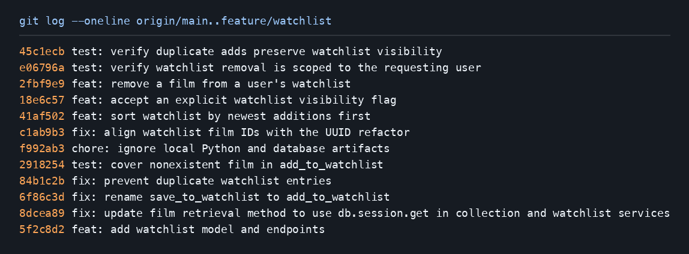

# PR Response Doc — CineLog Watchlist Feature

## AI Usage

Codex was used to inspect the collection service and existing tests, locate the watchlist function and its callers with a repository-wide search, apply the Comment 1 rename, and run the existing test suite. Codex also compared the collection deduplication pattern, implemented the Comment 2 duplicate check and HTTP conflict response, and verified duplicate and independent user/film cases in an isolated in-memory database. For Comment 3, Codex used the existing nonexistent-film collection test as a model, added the watchlist equivalent, and ran the targeted test and full suite. For the remaining work, I selected public-by-default visibility and newest-first ordering. Codex drafted the rationale around those choices, identified the API’s lack of caller identity, and verified the rebase, tests, and conventional commit subjects.

## Comment 1 — Rename

**What I did:** Renamed `save_to_watchlist()` to `add_to_watchlist()` in `services/watchlist_service.py`, following the `add_to_collection()` naming pattern. Updated both the import and the call inside `add_film()` in `routes/watchlist/watchlist.py`. This change preserves the existing endpoint and behavior.

**How I verified:** Before editing, a repository-wide `rg -n 'save_to_watchlist|add_to_watchlist' .` search identified the service definition, the route import, and the route call. After editing, `rg -n 'save_to_watchlist|add_to_watchlist' --glob '*.py' .` showed exactly those three references using the new name and no Python references using the old name. The old name appears here only to describe the rename. Ran `.venv/bin/python -m pytest tests/ -v`: all four existing tests passed. Those tests exercise collections, so I also checked the watchlist endpoint directly with Flask's test client to verify its updated import and call create a watchlist entry successfully.


## Comment 2 — Deduplication

**What I did:** Followed the existing `add_to_collection()` pattern in `services/collection_service.py`: after verifying the film exists, query for an entry matching both `user_id` and `film_id` with `.filter_by(...).first()`. The collection service raises `AlreadyInCollectionError` when it finds that pair. The watchlist service now performs the equivalent check on `WatchlistEntry` and raises `AlreadyInWatchlistError` before adding or committing a second entry. The watchlist route converts that exception into a JSON error with HTTP 409, matching the collection route's conflict response. Different users can still save the same film, and a user can still save different films.

**How I verified:** Ran `.venv/bin/python -m pytest tests/ -v`; all four existing tests passed. In a separate in-memory database smoke check, the first API add returned 201; a repeated service call raised `AlreadyInWatchlistError`; and a repeated API add returned 409 with an error message. Confirmed the original user/film pair still had exactly one row. Adding the same film for another user and a different film for the original user both returned 201, leaving three distinct entries total. The final test suite also checks that a duplicate request cannot overwrite a private entry’s visibility.


## Comment 3 — Missing test

**What I did:** Added `test_add_to_watchlist_nonexistent_film_raises()` in `tests/test_watchlist.py`, modeled after `test_add_to_collection_nonexistent_film_raises()` in `tests/test_collection.py`. It follows the same in-memory app fixture, persisted sample user, application context, and `pytest.raises(FilmNotFoundError)` structure. The test uses a film ID that is absent from the catalog, explicitly confirms that absence, and checks that calling `add_to_watchlist()` raises the intended service error. It also verifies that no watchlist entry was saved. The ID is a syntactically valid UUID, so the test exercises the catalog lookup and the service error for an absent film.

**How I verified:** Ran `.venv/bin/python -m pytest tests/test_watchlist.py -v`: the new test passed. Then ran `.venv/bin/python -m pytest tests/ -v`: all five tests passed.

## Comment 4 — Default visibility

**My position:** Keep `public=True` as the default and accept `public: false` when someone saves a film for personal use.

**Reasoning:** A CineLog collection tells other people what someone has already watched. A watchlist can help them decide what to watch together next. Someone who finds a title while browsing should be able to save it in one action and have it marked for sharing. I kept this behavior explicit in the add endpoint and validated the JSON field as a boolean so a string such as `"false"` can’t silently become public.

**Tradeoff acknowledged:** A private default would let users build a personal backlog without thinking about disclosure. With a public default, someone who wants to keep a title personal has to make that choice when saving it. I favor keeping the shared-list use case easy in CineLog and giving each save an explicit override. The starter API persists this preference. Its GET endpoint takes a user ID and has no authenticated viewer identity, so the flag does not restrict access by itself.

## Comment 5 — Sort order

**My position:** Make date added, newest first, the default and use the entry ID to break timestamp ties.

**Reasoning:** A user might add a film after seeing a friend’s recommendation, then reopen CineLog while deciding what to watch that evening. The newest-first list puts that title near the top even if the user only remembers the recommendation and has forgotten the title. It also uses the same ordering as the collection screen, so both lists behave consistently when users return after saving something.

**Engagement with the reviewer’s point:** I agree that resurfacing recent additions is a good default. Alphabetical order helps when someone already knows the title and wants to scan a long list for it. Recent additions are harder to locate in that order when the title is unfamiliar. I chose recency for the default because it supports picking up where the user left off, and the API still includes each film’s title for clients that need a title lookup.

## Comment 6 — Rebase

**What conflicted:** Rebasing `feature/watchlist` onto `origin/main` stopped in `models.py`. The starter feature indexed an integer `WatchlistEntry.film_id`. Main had switched that foreign key and `Film.id` to UUID strings.

**How I resolved it:** I kept main’s UUID column during the replay, then restored the watchlist lookup index on that UUID column in a separate `fix:` commit. That commit also updated the service and endpoint UUID contract and returned HTTP 404 when a requested film UUID isn’t in the catalog, matching the collection endpoint.

**How I verified no conflict remains:** I verified that `origin/main` is an ancestor of the feature branch, checked for merge commits and conflict markers with Git, and exercised UUID adds, reads, duplicate handling, and missing-film handling with Flask’s test client. The full suite passed. I also used interactive rebase to rename the starter commit and fold its app registration adjustment into the watchlist feature commit.

## Stretch features

- **Removal.** `remove_from_watchlist(user_id, film_id)` follows `remove_from_collection()`: it finds the exact user/film pair, deletes and commits that entry, and returns `True`. If that pair is absent it raises `NotInWatchlistError`. The test verifies deletion, a second removal raising the error, and another user’s entry for the same film surviving.
- **Additional edge-case test.** Saving a private entry again with `public: true` must return HTTP 409 and leave exactly one private row. This catches a regression where retrying an add with different input would silently change a saved entry’s visibility.
- **Visibility flag.** Include `"public": false` or `"public": true` in the JSON body sent to `POST /watchlist/<user_id>/add`. Omitting the field defaults to `true`. Other JSON types return HTTP 400.

## Commit history



## PR Description

## Overview

CineLog users can save films they plan to watch and retrieve their watchlist with each film’s date added and visibility flag. The watchlist uses the catalog’s UUIDs and rejects repeated saves of the same film by the same user. The service also supports removing a saved film.

## Design decisions

- **Public by default.** CineLog’s community focus makes a saved list a useful source of recommendations and a way to coordinate what to watch next. Send `"public": false` for a film you want to save privately. This API stores the visibility preference. Enforcing it for other viewers requires a caller identity, which the starter’s GET endpoint does not have.
- **Newest additions first.** Returning to the watchlist after browsing brings the films you just saved to the top. This also matches the collection’s existing newest-first order.

## Manual testing

1. In an activated virtual environment, run `python -m pip install -r requirements.txt`. Start with a fresh local database so it uses the UUID schema.

   ```sh
   export DATABASE_URL="sqlite:///cinelog-watchlist-review-$(date +%s).db"
   python seed.py
   python -m flask --app app:create_app run --port 5056
   ```

2. In another terminal, run `curl -s http://127.0.0.1:5056/films/`. Copy the demo user ID from the seed output and the UUIDs for Alien and Spirited Away into the following variables.

   ```sh
   USER_ID='paste demo user ID'
   ALIEN_ID='paste Alien UUID'
   SPIRITED_ID='paste Spirited Away UUID'
   WATCHLIST="http://127.0.0.1:5056/watchlist/${USER_ID}"
   ```

3. Save Alien with the default visibility, then save Spirited Away with explicit private visibility. Both requests should return HTTP 201. Check for `"public": true` and `"public": false`, respectively.

   ```sh
   curl -i -H 'Content-Type: application/json' -d "{\"film_id\":\"${ALIEN_ID}\"}" "${WATCHLIST}/add"
   curl -i -H 'Content-Type: application/json' -d "{\"film_id\":\"${SPIRITED_ID}\",\"public\":false}" "${WATCHLIST}/add"
   ```

4. Run `curl -s "${WATCHLIST}"` and confirm Spirited Away appears before Alien. Repeat the Spirited Away POST with `"public": true` and expect HTTP 409. Repeat the GET and confirm the list still contains exactly two films and Spirited Away is still marked private.
5. POST `{"film_id":"00000000-0000-0000-0000-000000000000"}` to the add endpoint and expect HTTP 404. Send a valid film UUID with the string `"false"` as the visibility value and expect HTTP 400.
6. Run `python -m pytest tests/ -v` to verify the service removal and HTTP regression tests alongside the collection tests.
